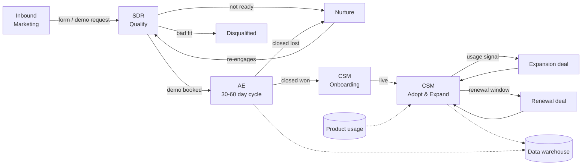

# CloudScale Analytics — GTM Motion Map

**Phase:** 01 Discovery · **Status:** Final · **Feeds:** 02 Design (data model, workflows, views)

Facts from the brief are marked **[brief]**. Everything else is a working assumption marked **[assume]**. Assumptions are reasonable for a Series B BI SaaS and can change during Design.

---

## 1. Company snapshot

| | |
|---|---|
| Product | Business intelligence platform **[brief]** |
| Stage / size | Series B, 50 employees **[brief]** |
| Model | Annual subscription, $12K–$120K ACV **[brief]** |
| GTM teams | Marketing → SDR → AE → CSM **[brief]** |
| Sales cycle | 30–60 days **[brief]** |
| Buyers | Buying committees: data leaders, analysts, IT/security, finance **[brief + assume]** |

**Segments by ACV [assume]**

| Segment | ACV | Typical buyer | Cycle |
|---|---|---|---|
| Growth | $12K–$30K | Head of Data / Ops lead | ~30 days |
| Mid-Market | $30K–$75K | Director of Analytics + IT | ~45 days |
| Enterprise | $75K–$120K | VP Data / CFO + Security + Procurement | ~60 days |

---

## 2. End-to-end motion



---

## 3. Stage by stage

### Stage 1 — Inbound capture (Marketing)

| | |
|---|---|
| **Goal** | Capture every inbound lead with source and intent. |
| **Entry** | Form fill: demo request, content download, webinar, contact sales **[assume]** |
| **Key data** | Person (name, email, title), Company (domain → enrichment), source, UTM campaign, form intent |
| **Exit** | Lead is created, enriched and routed to an SDR (or to nurture if low intent). |
| **Automation** | Typeform → Attio (native) → enrich company → route. |
| **Metrics** | Leads by source, MQL rate, cost per lead |
| **Pain if missing** | Leads sit unrouted; no source attribution. |

### Stage 2 — SDR qualification

| | |
|---|---|
| **Goal** | Respond fast, qualify fit and intent, book demos. |
| **Entry** | Routed lead (MQL). |
| **Routing [assume]** | By segment (company size / est. ACV), then round-robin inside the SDR pod. |
| **SLA [assume]** | First touch within 1 business hour for demo requests. |
| **Qualification [assume]** | Fit: employee count, data stack (warehouse in place?), use case. Intent: demo request vs content. |
| **Exit** | Demo booked → deal created **or** Nurture (with reason) **or** Disqualified (with reason). |
| **Automation** | Slack alert to SDR on new lead; SLA breach alert; follow-up task. |
| **Metrics** | Speed-to-lead, MQL → SQL rate, demos booked per SDR |

### Stage 3 — AE sales cycle (30–60 days)

| | |
|---|---|
| **Goal** | Win the deal across a multi-person buying committee. |
| **Entry** | Demo booked / SQL. |
| **Deal stages [assume]** | Demo Scheduled → Discovery → Technical Evaluation (connect a data source / POC) → Business Case & Proposal → Security & Procurement → Negotiation → Closed Won / Closed Lost |
| **Buying committee [brief + assume]** | Economic Buyer, Champion, Technical Evaluator (data/IT), End Users (analysts), Security, Procurement, Blocker |
| **Exit** | Closed Won (→ subscription + onboarding) or Closed Lost (→ loss reason, back to nurture). |
| **Automation** | Stage-change tasks, stalled-deal alerts, committee coverage check. |
| **Metrics** | Win rate by segment, cycle length, stage conversion, deals single-threaded vs multi-threaded |
| **Pain if missing** | Deals die when the one contact goes quiet; no view of who else is involved. |

### Stage 4 — CSM onboarding

| | |
|---|---|
| **Goal** | Reach first value fast. |
| **Entry** | Closed Won. |
| **Milestones [assume]** | Kickoff → Data source connected → First dashboard live → Team trained → Go-live |
| **Exit** | Customer is live and active users ≥ target. |
| **Automation** | Closed Won → create subscription, assign CSM, start onboarding, Slack handoff to CS. |
| **Metrics** | Time to first dashboard, time to go-live |

### Stage 5 — Adoption, expansion and renewal (CSM)

| | |
|---|---|
| **Goal** | Grow and keep revenue (NRR). |
| **Usage signals [brief + assume]** | Seats used vs seats bought, weekly active users, dashboards created, data connectors used, last active date |
| **Expansion triggers [assume]** | Seat utilisation ≥ 90%; new team/department users; usage growth over 30 days |
| **Risk triggers [assume]** | WAU drop > 30%; no login for 14 days; champion leaves |
| **Renewal [assume]** | 12-month term; renewal deal opens 90 days before end date |
| **Exit** | Expansion deal, renewal deal, or churn risk flagged. |
| **Automation** | Usage sync → health score → expansion/risk alert → task for CSM. |
| **Metrics** | NRR, GRR, expansion ARR, health score distribution |

### Stage 6 — Analytics (data warehouse) **[brief]**

| | |
|---|---|
| **Goal** | Leadership and RevOps analyse the funnel and revenue in the warehouse / BI. |
| **Direction** | Attio → warehouse (ETL) for pipeline, deals, subscriptions. Warehouse → Attio (reverse ETL) for product usage. |
| **Ironic fit** | CloudScale sells BI. Their own GTM data should be queryable in their own product. |

---

## 4. Handoffs (where deals get dropped)

| Handoff | From → To | What must transfer | Trigger |
|---|---|---|---|
| Lead → SDR | Marketing → SDR | Source, intent, enriched company | Lead created |
| SQL → AE | SDR → AE | Qualification notes, pain, committee so far | Demo booked |
| Won → CS | AE → CSM | Contract terms, goals, stakeholders, technical setup | Closed Won |
| CS → AE (expansion) | CSM → AE | Usage signal, new stakeholders | Expansion trigger |

Every handoff gets an automation: owner assigned, Slack alert, task with context.

---

## 5. What the CRM must track (requirements)

| # | Requirement | Source |
|---|---|---|
| R1 | Capture inbound leads with source, UTM and intent | brief |
| R2 | Route leads to the right SDR by segment, with SLA tracking | brief |
| R3 | Lifecycle stage on people and companies (Lead → MQL → SQL → Opportunity → Customer → Churned) | assume |
| R4 | Deal pipeline with stages, ACV, segment, deal type (New / Expansion / Renewal) | brief + assume |
| R5 | Buying committee: the key decision roles **per deal** | brief |
| R6 | Subscriptions: plan, ARR, seats, start/end dates, status | brief (annual subs) |
| R7 | Product usage per customer account: seats used, WAU, dashboards, last active | brief |
| R8 | Health score and expansion / risk flags | brief |
| R9 | Onboarding milestones and time-to-value | brief |
| R10 | Sync CRM data to the warehouse; pull usage back | brief |
| R11 | Role-based views for SDR, AE, CSM, leadership | brief |

---

## 6. Data model implications (input to 02 Design)

The brief requires **2 custom objects**. The strongest candidates are the ones that standard objects (People, Companies, Deals) cannot model well.

| Need | Option A | Option B | Leaning |
|---|---|---|---|
| R6 Subscriptions | **Custom object `Subscriptions`** (links Company, originating Deal, renewal Deal) | Attributes on Company | **Custom object.** A company can hold several subscriptions over time; renewals and ARR roll up cleanly; it's the core record for the warehouse sync. |
| R7 Product usage | **Custom object `Product Workspaces`** (one per product tenant; links Company, Subscription, user People) | Usage attributes on Company | **Custom object.** One company can run several workspaces (teams/regions). Usage syncs land on a stable record keyed by workspace ID. |
| R5 Buying committee | **Role fields on Deals**: `economic_buyer`, `champion`, `technical_evaluator`; others in `associated_people` | People list with role/sentiment entries; junction object `Deal Stakeholders` | **Deal fields.** Visible where AEs work, simple coverage filter, no list. Tradeoff: one person per role, no sentiment. |
| R9 Onboarding | Companies **list** "Onboarding" with a status per milestone | Custom object `Onboarding Projects` | **List.** Onboarding is a process on a company, not a long-lived record. |

**Proposed relationship sketch (to confirm in Design):**

```
Companies 1 ── * Deals (type: New / Expansion / Renewal)
Companies 1 ── * Subscriptions ── 1 originating Deal
Companies 1 ── * Product Workspaces ── * People (users)
Subscriptions 1 ── * Product Workspaces
Deals ── People  (economic_buyer, champion, technical_evaluator + associated_people)
```

---

## 7. Workflow candidates (input to 02 Design)

| # | Workflow | Motion | Integration |
|---|---|---|---|
| W1 | Inbound lead capture + routing | Stage 1 → 2 | **Typeform (native)** |
| W2 | Speed-to-lead and handoff alerts | Stages 2–4 | **Slack (native)** |
| W3 | Closed Won → create subscription, assign CSM, start onboarding | Stage 3 → 4 | Attio |
| W4 | Usage threshold → expansion or risk alert + CSM task | Stage 5 | Attio + Slack |
| n8n | Product usage → Attio `Product Workspaces` (with error handling), or company enrichment via Apollo | Stage 5 / 1 | n8n + Attio API |
| Depth | Attio → warehouse sync (ETL) and usage back (rETL) | Stage 6 | Script / n8n |

Pick 3+ for the build. W1 (Typeform) covers the native-integration rule.

---

## 8. Open questions for Design — resolved in [build-plan.md](../02-design/build-plan.md)

1. Two custom objects: **`Subscriptions` + `Product Workspaces`.**
2. Buying committee: **role fields on Deals** (not a list or junction object). Tradeoff in build plan §7.
3. n8n use case: **product usage sync** (reverse ETL), tied to expansion.
4. Warehouse: **a new Supabase (Postgres) cloud project**, separate from the job-search dashboard.
